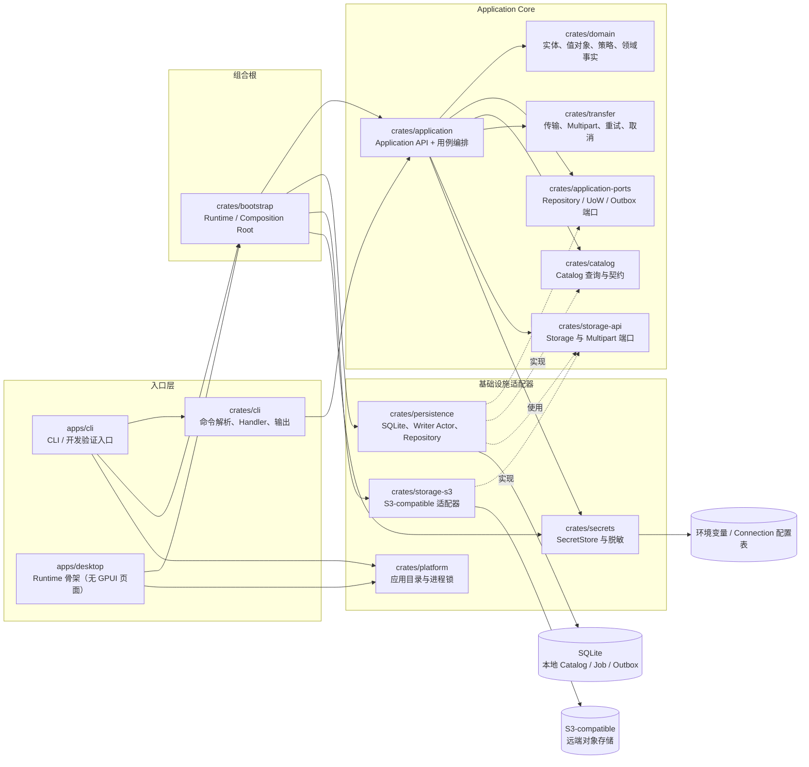
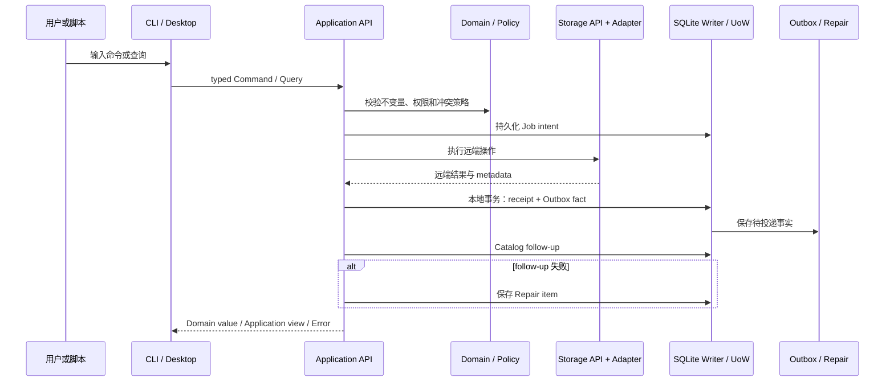

# rstore 架构、目录与开发规范

本文按当前源码编写，作为阅读代码、增加模块和评审变更时的共同约定。它描述“现在代码做
什么”，不把尚未接入运行时的接口误写成已完成的后台能力。

## 当前实现状态

- 当前可用的完整命令入口是 `apps/cli`；研发顺序是先用 CLI 验证底层能力，再实现桌面端，
  这不代表 CLI 的产品优先级更高。
- `apps/desktop` 目前只负责目录、进程锁、Bootstrap、Application API 和通知订阅，启动后
  输出 runtime ready；尚无 GPUI 页面。
- `crates/bootstrap::Runtime::open` 会打开 SQLite、执行迁移、恢复处于 processing 的 Outbox
  事件，并调用 `Application::initialize` 将遗留的非终态 Job 标记为 `interrupted`。
- 默认运行时组装 S3 `StorageFactory`、环境变量覆盖 Connection 配置凭据的 `SecretStore`、
  SQLite Repository、Multipart checkpoint、Outbox/Repair 和通知广播通道。
- `OutboxDispatcher` 提供 `dispatch_once`，但当前入口没有常驻消费循环或配置投影 Handler；
  通知广播也提供订阅/发布接口，Transfer 运行过程尚未自动发布到该通道。

## 1. 架构图

rstore 采用 **local-first** 架构。实施顺序是先完成 CLI 能力，借助 CLI 方便测试和验证
Domain、Application、Persistence/Adapter 等底层功能；功能稳定后再实现桌面端。CLI 和桌面端
最终共用同一个 Application Core。这里的“先 CLI”表示研发与验证顺序，不表示 CLI 在功能或
产品优先级上高于桌面端。入口层不复制业务逻辑，也不直接访问 SQLite 或 S3 SDK。

### 1.1 组件关系

实线表示调用或依赖，虚线表示“实现某个端口”。



核心边界如下：

| 层 | 主要职责 | 明确禁止 |
| --- | --- | --- |
| `domain` | 保存业务实体、不变量、Typed ID、值对象、状态机和领域事件 | 依赖 GPUI、AWS SDK、SQLite，执行 I/O |
| `application` | 组装 Service/Operations，编排用例、策略、任务和 Catalog follow-up | 在默认生产依赖图中直接依赖 SQLx、具体存储实现或 GPUI |
| `application-ports` | 定义本地 Repository、UnitOfWork、Outbox、Clock 等端口 | 暴露 SQLx 类型或具体数据库事务对象 |
| `catalog` | 定义本地 Catalog 的查询、排序、分页和 Repository 契约 | 依赖具体 SQLite 实现 |
| `transfer` | 执行上传、下载、复制、移动、Multipart、重试和取消 | 依赖 `persistence`；checkpoint 端口位于 `storage-api` |
| `storage-api` | 描述与 Provider 无关的 Storage、Capability 和 Multipart 协议 | 依赖具体 AWS/S3 SDK |
| `bootstrap` | 唯一的 Composition Root，打开数据库并组装 Storage、SecretStore、Outbox 和通知 | 承担业务规则或 CLI 输出；当前不运行常驻 Outbox 消费循环 |
| `persistence` | 实现 SQLite schema、迁移、读连接池、有界 Writer Actor 和 Repository | 依赖 `transfer` |
| `storage-s3` | 将 AWS SDK 映射到 `storage-api`，处理 S3-compatible 差异 | 依赖 GPUI 或向上层暴露 SDK 类型 |
| `crates/cli` / `apps/*` | 解析输入、调用 Application API、渲染结果、映射退出码；`apps/*` 负责 Runtime/锁 | 在入口业务代码中直接读写 SQLite、调用 AWS SDK、复制业务编排 |

### 1.2 远端变更与本地一致性

远端 Provider 与本地 SQLite 不共享跨系统事务。远端操作成功后，先保存本地事实，再执行
Catalog follow-up；follow-up 失败必须留下可查询的 Repair item，不能把已经成功的远端操作
报告成失败，也不能盲目重复覆盖或删除。



Outbox 事件要求 `event_id` 幂等、同一 aggregate version 保序、失败可重试；进度和桌面通知
属于运行时消息，不写入 Domain Event。

当前 Outbox 的持久化、重试和 Repair 数据结构已经存在，但 `dispatch_once` 需要调用者提供
`OutboxHandler`，CLI/Desktop 尚未把它接成后台消费者；因此“Outbox 已落库”不等于“事件已被
投影处理”。

## 2. 目录结构

以下是当前 workspace 的标准层级。代码目录使用职责划分，测试与文档不混入生产模块。

```text
.
├── Cargo.toml                 # workspace、统一依赖、lint 与构建配置
├── Cargo.lock                 # workspace 锁定的依赖版本
├── README.md                  # 项目入口、能力概览和常用命令
├── CONTEXT.md                 # 领域术语与边界说明
├── AGENTS.md                  # 协作规则与架构工作约定
├── apps/
│   ├── cli/
│   │   ├── Cargo.toml
│   │   └── src/main.rs        # 薄 CLI 进程入口
│   └── desktop/
│       ├── Cargo.toml
│       └── src/main.rs        # 最小桌面 Runtime/API/通知入口
├── crates/
│   ├── domain/                # 领域核心：实体、策略、ID、事件、错误
│   ├── application-ports/     # Application 需要的本地端口
│   ├── application/           # 上下文 API 与用例编排
│   ├── bootstrap/             # 生产 Composition Root
│   ├── catalog/               # Catalog 查询模型与契约
│   ├── transfer/              # 传输引擎
│   ├── storage-api/           # Provider-neutral Storage 端口
│   ├── storage-s3/            # AWS SDK / S3-compatible 适配器
│   ├── persistence/           # SQLite、迁移、Actor、Repository
│   ├── secrets/               # SecretStore、环境变量与 Connection 凭据访问
│   ├── platform/              # 应用目录、锁和平台能力
│   ├── cli/                   # Clap 命令树、Handler、输出与退出码
│   ├── test-support/          # FakeStorage、TempDb、TestClock、契约辅助
│   └── application-test-support/ # Application 测试组合与临时依赖
├── ui/
│   ├── ui-kit/                # 可复用 UI 基础组件的 crate
│   └── desktop-ui/            # 桌面 UI crate；完整 GPUI 页面暂缓
├── docs/
│   ├── architecture-guide.md # 本文：架构、目录、命名和数据流
│   ├── cli-guide.md           # CLI 教程与命令参考
│   └── prd.md                 # 产品需求与范围
└── xtask/
    ├── Cargo.toml
    └── src/main.rs            # 构建、打包等开发辅助命令
```

### 2.1 目录职责细化

| 路径 | 应放置的内容 | 不应放置的内容 |
| --- | --- | --- |
| `crates/domain/src/` | 纯领域模型、策略、Typed ID、错误、事件 | SQL 查询、SDK Client、文件系统操作 |
| `crates/domain/src/contexts/` | Registry、Catalog、Transfer、AccessDiagnostics 的上下文标识和领域边界 | Application handler 或持久化实现 |
| `crates/application/src/` | API、Command/Query、服务、任务编排、View/Page/Report | CLI 参数解析、SQLite Row、AWS SDK 类型 |
| `crates/application-ports/src/` | Repository、Outbox、UnitOfWork、Clock 等接口 | 具体 Repository 实现 |
| `crates/persistence/src/` | SQLite Repository、编码转换、事务和 Writer Actor | 远端传输流程 |
| `crates/persistence/migrations/` | 按时间排序的嵌入式 SQL migration | 业务逻辑或运行时动态 SQL 模板 |
| `crates/storage-api/src/` | `Storage`、能力模型、远端 DTO、Multipart 协议 | AWS SDK 调用 |
| `crates/storage-s3/src/` | S3 Client、错误分类、Provider capability 映射 | Application 用例编排 |
| `crates/cli/src/handlers/` | 将 CLI 参数转换为 Command/Query，调用 API 并渲染 | 直接访问 DB 或 Provider |
| `crates/*/tests/` | 对应 crate 的集成、契约和端到端边界测试 | 生产实现代码 |
| `crates/cli/tests/snapshots/` | `insta` 输出快照，由测试生成 | 手工维护的业务数据源 |

`*.DS_Store`、构建产物和临时数据库不属于标准仓库结构，不应作为源码或文档提交。

每个 workspace crate 的最小内部结构如下；`tests/` 按需创建：

```text
crates/<crate-name>/
├── Cargo.toml                 # 包名、依赖和 feature
├── src/                       # 生产代码，入口为 lib.rs 或 main.rs
└── tests/                     # 集成、契约和快照测试（可选）
```

## 3. 命名与规范

### 3.1 文件和目录命名

| 对象 | 规则 | 示例 |
| --- | --- | --- |
| workspace / crate 目录 | 小写 kebab-case | `application-ports/`、`storage-s3/` |
| Cargo package | 业务库使用 `rstore-<职责>`；二进制按产品名命名，开发辅助包可例外 | `rstore-application`、`rstore`、`rstore-desktop`、`xtask` |
| Rust 源文件 / 模块 | 小写 snake_case | `remote_object.rs`、`catalog_follow.rs` |
| 库入口 | 使用 `src/lib.rs`；二进制入口使用 `src/main.rs` | `crates/domain/src/lib.rs`、`apps/cli/src/main.rs` |
| 分组模块 | 目录名与模块名一致；入口使用 `mod.rs` 或父模块声明 | `crates/cli/src/handlers/` |
| 数据库迁移 | `YYYYMMDDHHMMSS_description.sql`，描述用 snake_case | `20260819000001_baseline.sql` |
| 集成 / 契约测试 | `tests/<能力>.rs`，按边界而不是按实现类命名 | `tests/repository.rs`、`tests/contract.rs` |
| CLI 快照 | 放在对应测试目录的 `snapshots/` 下，由测试生成 | `tests/snapshots/*.snap` |
| Markdown 文档 | 小写 kebab-case；若新增 ADR 再使用编号前缀 | `cli-guide.md`、`architecture-guide.md` |

### 3.2 Rust 符号命名

- 类型、Trait、API、Command、Query、DTO 使用 `PascalCase`；函数、方法、模块和字段使用
  `snake_case`；常量使用 `SCREAMING_SNAKE_CASE`。
- 业务 ID 必须使用 Domain Typed ID，例如 `ConnectionId`、`BucketId`、`JobId`、
  `WorkspaceId`；不要在业务接口中用裸 `String` 或 `Uuid` 替代。
- 远端引用先由 `expand_reference(s)` 将短引用解析为 canonical
  `<connection-id>/<bucket>/<key>` 字符串，再由 Application 的 `RemoteUri` 解析；需要稳定
  Catalog / Outbox 身份时才构造由 `connection_id + bucket_id + object_path` 组成的
  `RemoteLocator`。不要把 `RemoteLocator` 写成所有流程的唯一中间类型。
- 稳定的写入用例使用 `*Command`，读取用例使用 `*Query`；部分 Service 入口使用明确的
  `*Input`。Application API 的返回值既可能是 Domain 类型，也可能是 Application-facing 的
  `*View`、`*Page`、`*Report` 或 `*Outcome`，但不暴露 SQLite Row。
- 端口使用语义名：本地状态通常为 `*Store` 或 `*Repository`，事务边界为 `UnitOfWork`，
  Provider 能力为 `Storage` / `StorageFactory`；具体实现使用 `*Repository`、`*Adapter` 或
  `*Factory`。
- 领域事实使用 `*Event` 和 `EventEnvelope`；传输进度、桌面通知等运行时消息使用
  `ProgressEvent`、`JobNotification` 等独立命名，不与领域事件混用。
- 错误统一使用 `rstore_domain::Error` 及稳定 `ErrorCode`。输入校验使用
  `Error::invalid_input` 等构造函数；底层错误使用 `with_source` 保留原因，context 不得
  包含 Secret。

### 3.3 数据流规则

所有新功能都应能沿着下面的方向解释；如果需要反向依赖，应先更新架构文档并说明理由。

1. **边界逐层规范化。** `crates/cli` 或桌面输入层负责解析字符串、路径和选项；远端短引用
   先经 `expand_reference(s)` 解析为 canonical 字符串，再由 `RemoteUri` 解析。进入需要
   Catalog / Outbox 稳定身份的流程后使用 Typed ID、`RemoteLocator` 和值对象。
2. **入口只负责组装和呈现。** `apps/cli` / `apps/desktop` 可以初始化运行时、目录、锁和
   tracing，但业务动作必须经由 Application API；CLI 只渲染 API 返回值、JSON envelope
   和退出码。
3. **Bootstrap 负责替换实现。** 只有 `crates/bootstrap` 选择并组装 SQLite、S3 adapter、
   SecretStore、Outbox dispatcher、Clock 和通知通道，并注入 `ApplicationDependencies`；当前
   Runtime 会恢复 processing 状态，但不会自动启动常驻 Outbox 消费循环。
4. **Domain 只做业务判断。** Domain 保存不变量、状态机和业务事实，不打开文件、数据库或
   网络，不持有 Storage Client。
5. **Application 负责用例编排。** Application 组合 Domain、端口、Catalog 和 Transfer，
   负责权限 guard、冲突策略、Job 生命周期和 follow-up；不得把具体基础设施类型泄漏给入口。
6. **本地写入走受控边界。** Repository 写入经过有界 SQLite Writer Actor；读查询使用只读
   连接池；多语句本地操作通过 `persistence::tx::atomically` 执行。Application 的
   `UnitOfWork` 当前只承载 `OutboxOnly`、`RemoteMutation`、`RepairOnly` 三类操作，其中
   `RemoteMutation` 保证 receipt 与 Outbox fact 同一事务提交；schema 只由
   `crates/persistence/migrations/` 建立或迁移。
7. **远端访问经过 Storage 端口。** Application/Transfer → `storage-api` →
   `storage-s3` → Provider；除 `storage-s3` 外不得调用 AWS SDK，`persistence` 不得依赖
   `transfer`。
8. **Secret 只通过 SecretStore。** Connection 配置统一保存凭据字段；Secret 值使用
   `Secret<T>`，只在适配器实际需要时解析。它不得进入导出配置、Application API JSON、
   错误 context 或日志。`tls_verify` 默认开启；当前 `--tls-verify=false` 只会保存配置，S3 适配器
   尚未据此安装自定义证书校验器。
9. **远端变更先记录事实再做本地跟进。** 典型顺序是：`Job intent` → 远端操作 →
   `RemoteMutationReceipt + Outbox fact` → Catalog follow-up → 失败时 `Repair item`。
10. **事件与通知分离。** Domain Event 是可持久化的业务事实；Outbox 负责幂等、顺序、重试
    和失败记录；进度事件和桌面通知是运行时消息，不写入 Domain Event。当前 Transfer 不会
    自动向 Bootstrap 的广播通道发布进度，且入口没有注册 Outbox 投影 Handler。
11. **输出与日志分流。** 结果和 JSON envelope 写 stdout；进度、warning、日志写 stderr。
    JSON 不输出持久化 Row 或 Secret；核心 `Error` 内部保留稳定 code、retryable、source 和
    结构化 context，当前 CLI JSON envelope 对外输出 code、message、retryable。
12. **外部输入不得导致 Panic。** 参数、URI、Provider 返回值和文件系统错误映射为稳定
    Domain Error；内部数据损坏可以显式失败，但不得静默修正。

### 3.4 新增功能的推荐落点

新增一个业务能力时，按以下顺序选择代码位置：

```text
Domain 实体 / 策略 / 状态
    → Application port（若需要新的外部能力）
    → Application Command/Query + Service/API
    → Persistence / Storage adapter 实现
    → CLI Handler 或 Desktop consumer
    → Domain / contract / repository / CLI snapshot 测试
```

不要为了让入口“方便”而跳过 Application，也不要把一次性业务逻辑下沉到通用工具模块。

## 4. 相关文档

- [`README.md`](../README.md)：项目概览、当前能力和构建命令。
- [`CONTEXT.md`](../CONTEXT.md)：领域术语、上下文和一致性语义。
- [`docs/cli-guide.md`](cli-guide.md)：CLI 使用教程与命令参考。
