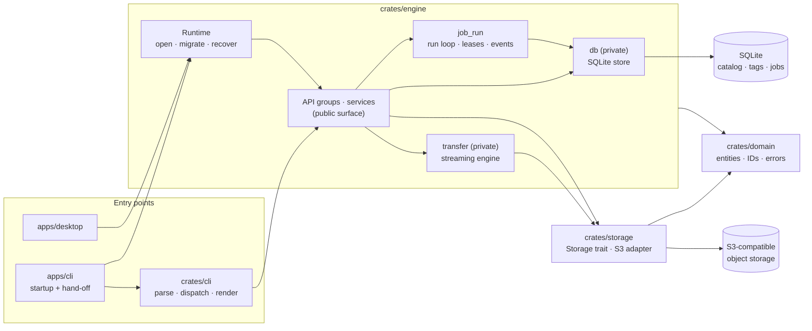
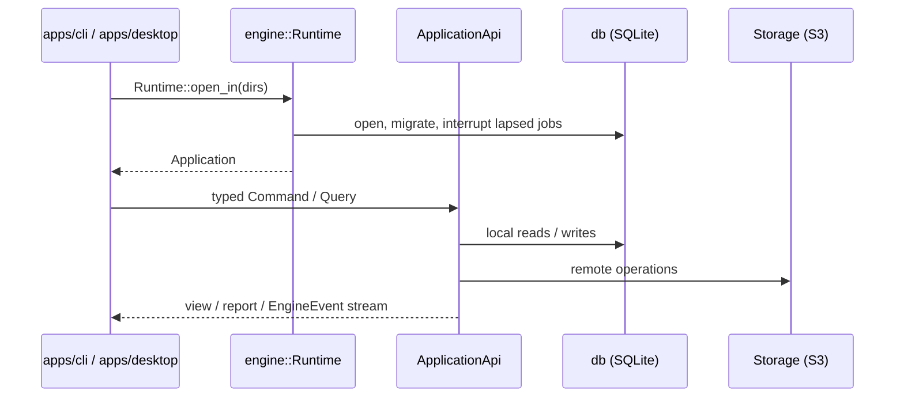
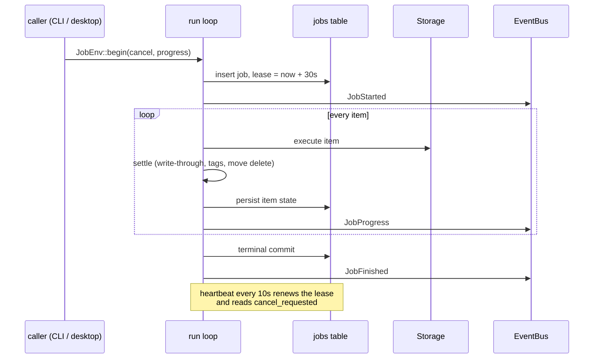

# rstore Architecture Guide

This document describes how the source code is actually structured: the crate
map, the dependency rules each change must respect, the data-flow constraints
that keep remote and local state honest, and the naming conventions used
across the workspace. Read it before adding a module or reviewing a change.

## 1. What the system does

rstore is a local-first workbench for S3-compatible object storage: register
endpoints, group buckets into workspaces, tag and search objects across
providers, and move data around. A CLI (`apps/cli`) is the complete automation
surface today; a GPUI desktop client is planned and consumes the same engine.
The CLI-first order is a development and validation order, not a product
priority.

Three decisions shape everything below:

1. **The provider is the source of truth; the catalog is a cache.** The local
   catalog holds every object of an *indexed* bucket plus any *tagged* object.
   Remote changes made through rstore update it best-effort; listings and index
   refreshes correct whatever drifted, including changes made outside rstore.
2. **SQLite is the application's file format, not an adapter.** The engine
   calls its repositories directly. The one seam that is genuinely variable —
   the object store — stays behind a trait.
3. **Several processes share one data directory.** There is no process lock:
   SQLite in WAL mode arbitrates writers, and running jobs hold leases, so the
   CLI can run next to the desktop, or next to itself.

### 1.1 Component map



At run time each entry point opens a `Runtime`, takes the `ApplicationApi`
handle, and drives it with typed commands and queries. The desktop also
subscribes to the engine's event stream.



### 1.2 Crate responsibilities

| Crate | Owns | Must never do |
| --- | --- | --- |
| `domain` | Entities, value objects, typed IDs, error model, conflict decision table, job state machine, outcome vocabulary, clock abstraction | Depend on GPUI, an SDK, or SQLite; perform I/O; panic on external input |
| `storage` | The provider-neutral `Storage` trait, multipart sessions, and the S3 adapter behind them | Depend on SQLite or GPUI; leak SDK types upward |
| `engine` | API groups and services, the SQLite store (`db`), the streaming transfer engine (`transfer`), the run loop with job leases, catalog write-through, the event bus, and the `Runtime` that wires it all | Depend on GPUI; expose `db`, `transfer`, or SDK types through its public surface |
| `cli` (`crates/cli`, `apps/cli`) | Parse input, build commands/queries, render envelopes, map exit codes; the binary owns tracing and runtime startup | Touch SQLite or an SDK; contain business rules |
| `apps/desktop` | Desktop composition; GPUI pages attach to the API and its events | Depend on SQLite or an SDK directly |

## 2. Workspace layout

```text
.
├── Cargo.toml               # workspace, shared deps, lint configuration
├── crates/
│   ├── domain/              # entities, value objects, typed IDs, errors
│   ├── storage/             # Storage trait, s3/ adapter
│   ├── engine/
│   │   ├── migrations/      # embedded SQL schema
│   │   └── src/
│   │       ├── api.rs       # the public API groups
│   │       ├── app.rs       # wiring: the one place services are assembled
│   │       ├── runtime.rs   # process startup
│   │       ├── job_run.rs   # run loop, leases, live-job registry
│   │       ├── events.rs    # EngineEvent bus
│   │       ├── write_through.rs  # catalog cache follow-up of remote changes
│   │       ├── db/          # SQLite store (private)
│   │       ├── transfer/    # streaming engine, retry, resume (private)
│   │       ├── catalog/     # query vocabulary: filters, sorts, cursors
│   │       └── *.rs         # use-case services
│   └── cli/                 # command tree, handlers, envelope, exit codes
├── apps/
│   ├── cli/                 # the rstore binary
│   └── desktop/             # desktop composition (no GPUI pages yet)
├── ui/                      # GPUI crates (ui-kit, desktop-ui)
├── docs/                    # architecture, CLI guide, product requirements
└── xtask/                   # build and packaging helpers
```

Test code is owned by an independent verifier, not by the implementation side
(see `AGENTS.md`); the tree currently carries none. When added, tests live
beside the crate they cover in `crates/<crate>/tests/`, and CLI output
snapshots in `crates/cli/tests/snapshots/`.

## 3. Conventions

### 3.1 Naming

| Object | Rule | Example |
| --- | --- | --- |
| Crate directories / packages | kebab-case; packages prefixed `rstore-` | `rstore-engine` |
| Rust files and modules | snake_case, named for responsibility | `write_through.rs`, `job_run.rs` |
| Database migrations | `YYYYMMDDHHMMSS_description.sql` | `20260819000001_baseline.sql` |
| Integration tests | named for the boundary, not the class | `tests/store.rs`, `tests/leases.rs` |

Types, traits, commands, queries, and views are `PascalCase`; functions,
modules, and fields are `snake_case`. Write use cases take `*Command` or
`*Input` parameters; reads return domain types or `*View` / `*Page` /
`*Report` / `*Outcome` values. Runtime notifications are `EngineEvent`
variants; per-call progress is `Progress`.

Business identifiers are always newtypes from `rstore_domain::id`
(`ConnectionId`, `BucketId`, …) rendered as `<prefix>_<uuid>` strings; bare
`String`, `Uuid`, or integer identifiers are not accepted at service
boundaries. Services are concrete types; a trait exists only where more than
one implementation does (`Storage` and its decorators, `SettleHook`,
`PageSink`).

### 3.2 Comments and documentation

All comments are English and follow a three-tier standard:

1. **Module header** — one short `//!` block stating the module's single
   responsibility and its key contract.
2. **Public items** — `///` documentation with a one-line summary plus only
   the non-obvious contracts (errors, panics, invariants, units).
3. **Inline comments** — rare, and only to explain *why* an invariant,
   ordering guarantee, or upstream rule forces the shape of the code.

Internal requirement IDs do not appear in comments. Formatting is `rustfmt`
defaults via `rustfmt.toml`.

### 3.3 Data-flow rules

Every change must be explainable along these lines; a reverse dependency
requires updating this document first.

1. **Normalize at the edge.** The CLI parses strings and paths; short remote
   references are expanded once by `References` into a `RemoteUri` bound to
   the connection id. Inside the engine, addresses are typed or validated
   (`ObjectPath`).
2. **Entry points assemble and render.** Binaries initialize directories,
   tracing, and the runtime; business actions go through the API groups.
3. **One wiring point.** `Runtime` picks the database path, the storage
   factory, and the clock; `Application::new` assembles every service exactly
   once. The database carries the clock so every stamp shares one source.
4. **Local writes go through the gate.** The write side is a single-connection
   pool; multi-statement writes run in `BEGIN IMMEDIATE` transactions through
   `WriteGate::write_unit`. Reads use a read-only pool. A database another
   process holds past the busy timeout surfaces as retryable `DatabaseBusy`.
5. **Remote first, cache after.** The order is always: job row (leased) →
   remote operation → cache write-through → item state persisted. A
   succeeded remote mutation is never reported as failed because the cache
   could not follow; the item carries a note instead.
6. **Tags are user data.** They key on `(bucket, path)` and survive index
   toggles, rebuilds, and GC. Only rstore's own `rm` and `mv` drop or move
   them.
7. **Conflict decisions never overwrite blind.** Target probes yield three
   verdicts (free / taken / unknown); unknown re-probes once and then blocks
   the item.
8. **Provider access crosses the storage seam exactly once.** Retries live in
   one layer: every adapter the gateway issues is wrapped in
   `RetryingStorage`; the S3 SDK's own retries are disabled. Write guards wrap
   outside retry, so a refusal is never retried.
9. **Secrets stay sealed.** Credentials persist inside the connection row,
   live in memory as `Secret<T>`, never enter exports, generic JSON, logs, or
   error context, and render only as masked previews.
10. **Output discipline.** Results and JSON go to stdout; progress, warnings,
    and logs go to stderr. Destructive commands require `--yes` when no
    terminal can confirm them, and batch commands exit non-zero when any item
    fails.

### 3.4 Where a new capability goes

```text
domain entity / policy / state machine
    → engine service method (+ db repository method / migration if needed)
    → storage trait method (only if the provider must do something new)
    → CLI handler (or desktop consumer)
    → domain / store / storage-contract / snapshot tests
```

## 4. Catalog model

The catalog answers "what is in my storage" offline, and it is allowed to be
wrong in one direction only: stale, never invented.

| Rows | Kept for | Written by | Removed by |
| --- | --- | --- | --- |
| Every object of an indexed bucket | Name, path, and attribute search | `index run`, `ls --catalog` of the bucket, write-through | `index run --rebuild` (untagged stale rows), `index gc`, switching the index off |
| A tagged object in any bucket | Tag queries | Tagging (after a live `stat`), write-through | Its last tag going away (unindexed bucket only), rstore's `rm` / `mv` |

`find` therefore answers tag queries completely across the workspace, while a
name or attribute search covers indexed buckets only — the page names the
buckets it could not search (`unindexed`). Indexing is opt-in per bucket and
off by default; naming a bucket in `index run` switches it on.

## 5. Jobs, leases, and events

Uploads, downloads, copies, moves, and removals all run through one loop
(`job_run::run_items`):



- **Leases.** A job row carries `lease_owner` and `lease_expires_at`. Startup
  recovery (`Application::initialize`) interrupts only pending/running jobs
  whose lease lapsed, so another process's live job is left alone.
- **Cancellation.** `task cancel` cancels a job of this process immediately
  (the `LiveJobs` registry holds its token); for a job another process owns it
  sets `cancel_requested`, which the owner's heartbeat turns into a cancel; a
  job nobody owns any more is cancelled outright. A cancel request ends the
  run as `cancelled`, Ctrl+C as `interrupted`.
- **Resume.** Interrupted transfers resume by re-running the command: upload
  multipart checkpoints and download `.part` files live in the store and on
  disk.
- **Events.** `ApplicationApi::events()` is a broadcast stream of
  `EngineEvent` — job started / progress / finished, catalog changed for a
  bucket, tags changed for a workspace. Events are best-effort runtime
  messages: a lagging subscriber loses the oldest, nothing is replayed, and
  subscribers re-query the API for state. The CLI renders progress through the
  per-call `ProgressSink`, which the engine forwards into the same stream.

## 6. Related documents

- [`CONTEXT.md`](../CONTEXT.md) — one definition per domain term.
- [`docs/cli-guide.md`](cli-guide.md) — commands, flags, exit codes, envelopes.
- [`docs/prd.md`](prd.md) — product scope and boundaries.
- [`CONTRIBUTING.md`](../CONTRIBUTING.md) — development setup and gates.
