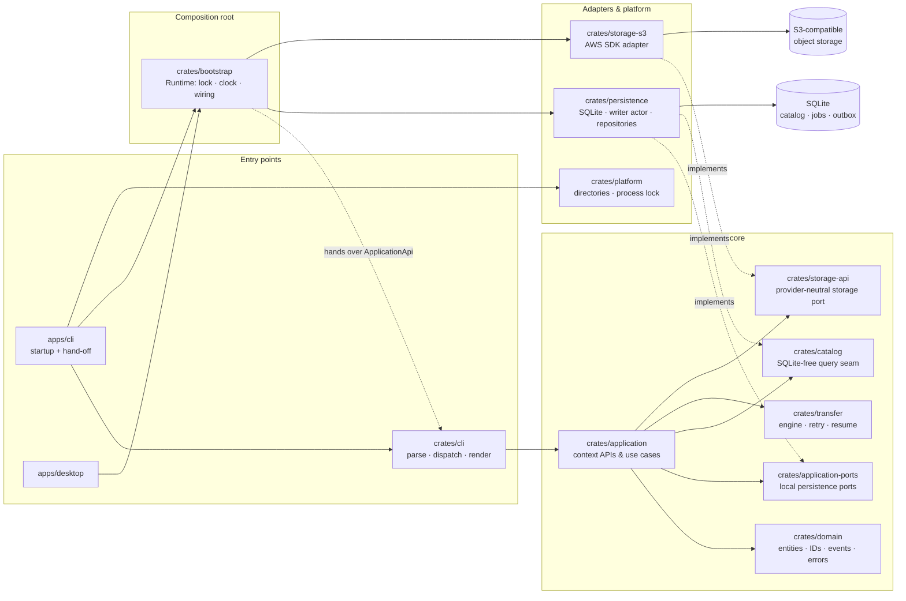
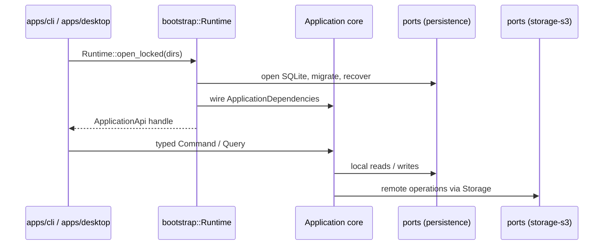
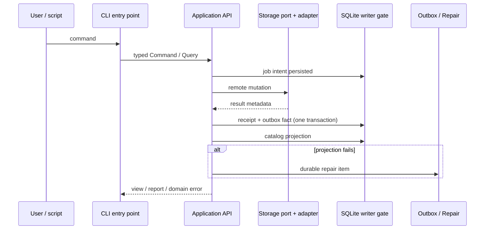

# rstore Architecture Guide

This document describes how the source code is actually structured: the crate
map, the dependency rules each change must respect, the data-flow constraints
that keep remote and local state consistent, and the naming conventions used
across the workspace. Read it before adding a module or reviewing a change.

## 1. What the system does

rstore is a local-first workbench for S3-compatible object storage. A CLI
(`apps/cli`) is the complete automation surface today; a GPUI desktop client
is planned and will consume the same application core. The CLI-first order is
a development and validation order, not a product priority.

### 1.1 Component map

The graph below maps **compile-time dependencies** — which crate needs which
other crate's types to build. Solid arrows are dependencies; dashed arrows
mean "implements a port". Note what the entry-point edges mean: `apps/cli`
depends on both `crates/cli` (handlers, typed against `ApplicationApi`) and
`crates/bootstrap` (the runtime that *builds* that API handle). The CLI
library itself never depends on bootstrap or on any adapter — it is
driveable against any `ApplicationApi`, including a fake-composed one in
tests.



At **run time** the shape is exactly the hexagonal call flow: each entry
point first runs through the composition root and then drives the core with
the assembled handle; adapters touch SQLite and the remote provider only
when core use cases call their ports:



Why the hand-off instead of letting the CLI library call bootstrap itself:
handlers stay testable against any `ApplicationApi` (the test fixture composes
fakes without SQLite), neither reusable library transitively depends on
infrastructure, and startup policy — database path, clock, storage factory,
lock or no lock — remains owned by the binary, where desktop and CLI can
differ freely.

### 1.2 Layer responsibilities

| Crate | Owns | Must never do |
| --- | --- | --- |
| `domain` | Entities, value objects, typed IDs, error model, domain events, conflict decision table, clock abstraction | Depend on GPUI, an SDK, or SQLite; perform I/O; panic on external input |
| `application` | Context APIs (`RegistryApi`, `CatalogApi`, …), use-case orchestration, gateway guard handles, job bookkeeping, mutation settlement | Depend on SQLx, an SDK, or GPUI in its normal dependency graph |
| `application-ports` | Every local persistence port plus the dependency-group vocabulary in `deps.rs` | Expose SQLx types or transaction objects |
| `catalog` | The SQLite-free query seam: filters, sort keys, keyset cursors, repository contracts | Contain SQL or know which database stores rows |
| `transfer` | The streaming engine: multipart, resume, retry, cancellation, conflict probes at targets | Depend on persistence; own catalog or registry concerns |
| `storage-api` | Provider-neutral `Storage`, multipart sessions, capability model | Call a concrete provider SDK |
| `bootstrap` | The sole composition root: opens the database, selects adapters, maps lock errors | Implement business rules or render output |
| `persistence` | SQLite schema/migrations, read pool, bounded writer actor, repositories | Depend on `transfer`; choose which adapter the app uses |
| `storage-s3` | Map AWS SDK onto `storage-api`, classify provider errors | Leak SDK types upward |
| `crates/cli`, `apps/*` | Parse input, build commands/queries, render envelopes, map exit codes; binaries own runtime/lock setup | Touch SQLite or an SDK in business paths |

## 2. Workspace layout

```text
.
├── Cargo.toml               # workspace, shared deps, lint configuration
├── crates/
│   ├── domain/              # entities, value objects, typed IDs, events, errors
│   ├── application-ports/   # local persistence ports + dependency vocabulary
│   ├── application/         # context APIs and use-case orchestration
│   ├── bootstrap/           # composition root and startup recovery
│   ├── catalog/             # SQLite-free catalog query seam
│   ├── transfer/            # streaming engine, retries, resume, cancellation
│   ├── storage-api/         # provider-neutral storage port + capabilities
│   ├── storage-s3/          # AWS SDK adapter
│   ├── persistence/         # SQLite: migrations, actor, repositories
│   ├── platform/            # app directories, cross-process lock
│   ├── cli/                 # command tree, handlers, envelope, exit codes
│   ├── test-support/        # FakeStorage, TempDb, contract suites
│   └── application-test-support/
├── apps/
│   ├── cli/                 # the rstore binary
│   └── desktop/             # desktop composition contract (no GPUI pages yet)
├── ui/                      # GPUI crates (ui-kit, desktop-ui)
├── docs/                    # architecture, CLI guide, product requirements
└── xtask/                   # build and packaging helpers
```

Tests live beside the crate they cover in `crates/<crate>/tests/`; CLI output
snapshots live in `crates/cli/tests/snapshots/`.

## 3. Conventions

### 3.1 Naming

| Object | Rule | Example |
| --- | --- | --- |
| Crate directories / packages | kebab-case; packages prefixed `rstore-` | `application-ports`, `rstore-cli` |
| Rust files and modules | snake_case, named for responsibility | `remote_object.rs`, `catalog_follow.rs` |
| Databases migrations | `YYYYMMDDHHMMSS_description.sql` | `20260819000001_baseline.sql` |
| Integration tests | named for the boundary, not the class | `tests/repository.rs`, `tests/schema_sync.rs` |

Rust symbol conventions: types, traits, commands, queries, and views are
`PascalCase`; functions, modules, and fields are `snake_case`. Stable write
use cases take `*Command` or `*Input` parameters; reads return domain types
or application-facing `*View` / `*Page` / `*Report` / `*Outcome` values.
Domain facts are `*Event`; runtime progress messages are deliberately named
differently (`ProgressEvent`, `JobNotification`) so delivery semantics stay
visible in the type name.

Business identifiers are always newtypes from `rstore-domain::id`
(`ConnectionId`, `BucketId`, …) rendered as `<prefix>_<uuid>` strings;
bare `String`, `Uuid`, or integer identifiers are not accepted at port or
service boundaries. Port names follow their role: local state ports are
`*Store` or `*Repository`, the transaction boundary is `UnitOfWork`, and the
provider surface is `Storage` / `StorageFactory`.

### 3.2 Comments and documentation

All comments are English and follow a three-tier standard:

1. **Module header** — one short `//!` block stating the module's single
   responsibility and its key contract.
2. **Public items** — `///` documentation with a one-line summary plus only
   the non-obvious contracts (errors, panics, invariants, units).
3. **Inline comments** — rare, and only to explain *why* an invariant,
   ordering guarantee, or upstream rule forces the shape of the code.

Internal requirement IDs do not appear in comments; behavior itself is the
contract. Formatting is `rustfmt` defaults via `rustfmt.toml`.

### 3.3 Data-flow rules

Every change must be explainable along these lines; a reverse dependency
requires updating this document first.

1. **Normalize at the edge.** The CLI parses strings and paths; short remote
   references are expanded once by `crates/application/src/reference.rs`
   into canonical `<connection-id>/<bucket>/<key>` form and parsed into
   `RemoteUri`. Inside the core, addresses are typed
   (`RemoteLocator`) or validated (`ObjectPath`).
2. **Entry points assemble and render.** Binaries initialize directories,
   tracing, and the runtime; business actions go through the application
   APIs. The CLI renders API values, the JSON envelope, and exit codes —
   nothing else.
3. **Bootstrap replaces implementations.** Only bootstrap picks the database
   path, the storage factory, and the clock, then hands them to
   `ApplicationDependencies`. The database carries the clock so every
   repository stamp shares one time source.
4. **Local writes go through the gate.** Writes run on a bounded writer
   actor; multi-statement operations enter through `WriteGate::write_unit`,
   where permit and transaction are acquired together. Reads use a
   connection pool that never takes write locks.
5. **Remote changes settle as one local unit.** The order is always:
   job intent → remote operation → receipt + outbox fact committed in one
   transaction → catalog projection → repair item on failure. A successful
   remote mutation is never reported as failed because its local follow-up
   struggled.
6. **Conflict decisions never overwrite blind.** Target existence probes
   yield three verdicts (free / taken / unknown). An unknown verdict re-probes
   once and then blocks the item — the same reaction as an unresolved ask —
   because a blind overwrite is the one outcome the policy table must never
   produce.
7. **Provider access crosses the storage port exactly once.**
   Application/Transfer → `storage-api` → `storage-s3` → provider.
8. **Secrets stay sealed.** Credentials persist inside the connection row,
   live in memory as `Secret<T>`, never enter exports, generic JSON, logs,
   or error context, and render only as masked previews.
9. **Events and notifications are different things.** Domain events are
   durable facts carried by the outbox with idempotency, ordering, and retry
   metadata; progress notifications are best-effort runtime messages.
10. **Output discipline.** Results and JSON go to stdout; progress, warnings,
    and logs go to stderr. Destructive commands require `--yes` when no
    terminal can confirm them, and batch commands exit non-zero when any item
    fails.

### 3.4 Where a new capability goes

```text
domain entity / policy / state machine
    → application port (only if a new external capability is required)
    → application command/query + service method
    → persistence or storage adapter implementation
    → CLI handler (or desktop consumer)
    → domain / contract / repository / snapshot tests
```

## 4. Consistency model

Remote providers and the local SQLite catalog cannot share a transaction, so
consistency is ordered instead of atomic:



The outbox keeps `event_id` idempotency, per-aggregate version ordering, and
attempt accounting; exhausted deliveries become repair rows in the same unit.
Delivery currently happens through the callable dispatcher
(`OutboxDispatcher::dispatch_once`); no resident consumer loop is wired yet,
so an appended fact is durable but not yet projected.

## 5. Related documents

- [`CONTEXT.md`](../CONTEXT.md) — one definition per domain term.
- [`docs/cli-guide.md`](cli-guide.md) — commands, flags, exit codes, envelopes.
- [`docs/prd.md`](prd.md) — product scope and boundaries.
- [`CONTRIBUTING.md`](../CONTRIBUTING.md) — development setup and gates.
